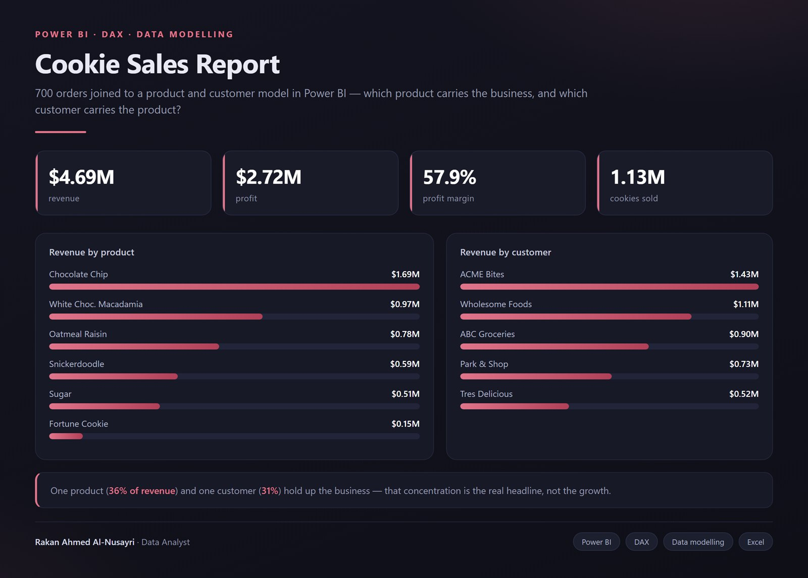

# Cookie Sales — Power BI Report

تقرير Power BI لمبيعات المخبوزات — 700 طلب و6 أصناف.



**The question:** Which cookie types actually drive the business, and how do
orders distribute across customers?

**What I did:**
- Modelled 3 sources in Power BI: `Orders` (700 rows), `Cookie Types` (6
  products), and `Customers` — related them into a working data model
- Built the report in Power BI Desktop (`cookie-sales-report.pbix`) with
  measures, slicers, and visuals

**Tools:** Power BI Desktop (data modelling, DAX measures, report design),
Excel, CSV

## Open it

Download `cookie-sales-report.pbix` and open it in **Power BI Desktop** (free).
The raw sources are in `data/` if you want to rebuild the model from scratch.

## Files

```
cookie-sales-report.pbix   the Power BI report
data/Orders.xlsx            700 order rows
data/Cookie Types.xlsx       6 product types
data/Customers.csv            customer list
```

---
Rakan Ahmed Al-Nusayri · rakanalnsyry8@gmail.com
